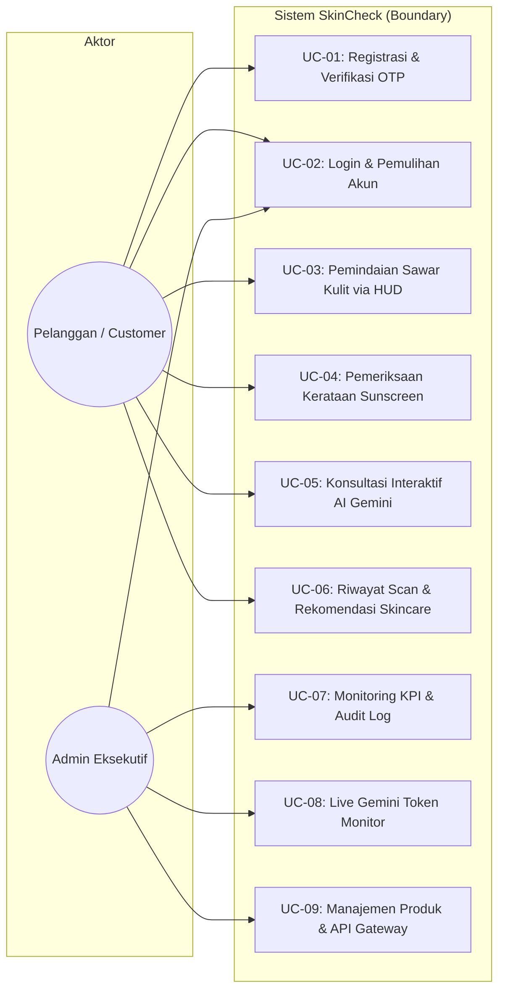
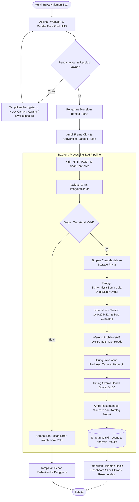
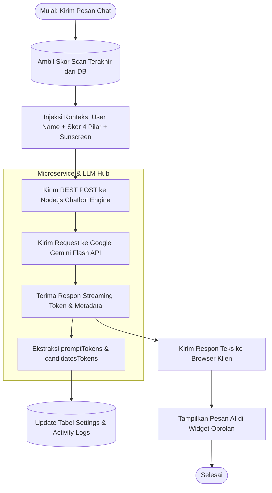
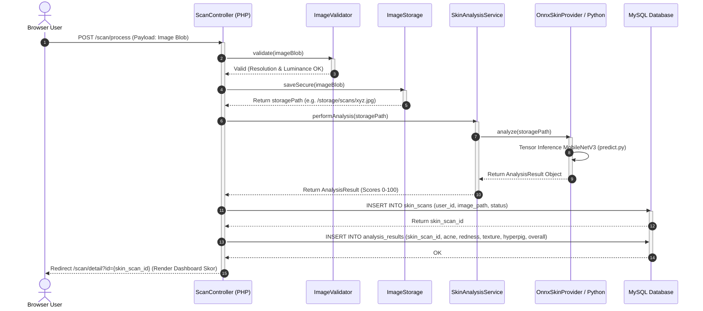
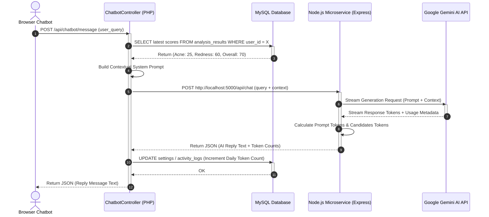
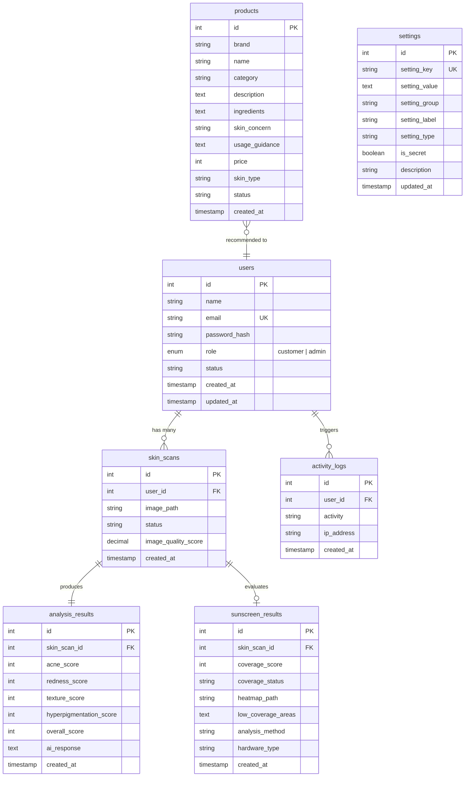

# DOKUMEN DESAIN PERANGKAT LUNAK (SOFTWARE DESIGN DOCUMENT - SDD)
## Berdasarkan Standar IEEE 1016 / ISO/IEC/IEEE 42010

---

# 🌿 SKINCHECK: AI-Powered Skin Barrier & Sunscreen Analysis Platform
**Arsitektur Sistem, Pemodelan 4 Diagram UML, Entity-Relationship Diagram, & Desain Antarmuka UI/UX**

* **Mata Kuliah**: Rekayasa Perangkat Lunak (TIKB2503021) — 4 SKS (2 Teori + 2 Praktik)
* **Program Studi**: S1 Teknik Informatika — STMIK IKMI Cirebon
* **Penyusun / Mahasiswa**: Satria Fibi Saputra (NIM: 41257159)
* **Dosen Pengampu**: Yudhistira Arie Wijaya, M.Kom., CDS.
* **Tema Topik Kelompok**: *Smart Healthcare & Public Service AI*
* **Sifat Proyek**: Mandiri / Perorangan (*100% Individual Ownership & Full-App Build*)
* **Versi Dokumen**: 1.0.0
* **Tanggal Rilis**: 17 November 2026

---

## DAFTAR ISI
1. [BAB I: GAMBARAN UMUM ARSITEKTUR SISTEM](#bab-i-gambaran-umum-arsitektur-sistem)
   - 1.1 Gaya Arsitektur (Architectural Style & Pattern)
   - 1.2 Topologi Komponen & Distribusi Fisik
2. [BAB II: USE CASE DIAGRAM & SKENARIO SISTEM](#bab-ii-use-case-diagram--skenario-sistem)
   - 2.1 Diagram Use Case Sistem
   - 2.2 Identifikasi Aktor
   - 2.3 Tabel Skenario Use Case Utama (UC-01 s.d. UC-04)
3. [BAB III: ACTIVITY DIAGRAM ALUR BISNIS & AI](#bab-iii-activity-diagram-alur-bisnis--ai)
   - 3.1 Activity Diagram: Pemindaian Wajah & Inferensi Sawar Kulit
   - 3.2 Activity Diagram: Konsultasi Interaktif AI Gemini Sadar-Konteks
4. [BAB IV: CLASS DIAGRAM BERORIENTASI OBJEK & KEPATUHAN SOLID](#bab-iv-class-diagram-berorientasi-objek--kepatuhan-solid)
   - 4.1 Diagram Kelas Sistem (Class Diagram)
   - 4.2 Analisis Kepatuhan 5 Prinsip SOLID (SRP, OCP, LSP, ISP, DIP)
5. [BAB V: SEQUENCE DIAGRAM ALUR PERTUKARAN PESAN](#bab-v-sequence-diagram-alur-pertukaran-pesan)
   - 5.1 Sequence Diagram: Alur Analisis Wajah & Penyimpanan Skor
   - 5.2 Sequence Diagram: Alur Chatbot Gemini & Pelacakan Token
6. [BAB VI: ENTITY-RELATIONSHIP DIAGRAM (ERD) & STRUKTUR BASIS DATA](#bab-vi-entity-relationship-diagram-erd--struktur-basis-data)
   - 6.1 Diagram Konseptual & Fisik Relasi Antar-Entitas
   - 6.2 Kamus Data & Relasi Integritas Referential
7. [BAB VII: PERANCANGAN UI/UX FIGMA & SITEMAP NAVIGASI](#bab-vii-perancangan-uiux-figma--sitemap-navigasi)
   - 7.1 Sitemap & Struktur Alur Halaman
   - 7.2 Spesifikasi Layar Kunci & Walkthrough Prototipe Figma
8. [PENGESAHAN DOKUMEN](#pengesahan-dokumen)

---

## BAB I: GAMBARAN UMUM ARSITEKTUR SISTEM

### 1.1 Gaya Arsitektur (Architectural Style & Pattern)
Platform **SkinCheck** dibangun menggunakan perpaduan pola arsitektur **Model-View-Controller (MVC)** yang diperluas dengan **Service-Oriented Decoupling** pada backend PHP, serta **Microservice Event-Driven** pada komponen asisten cerdas Node.js:

1. **Presentation Layer (View & Client Heuristics)**:
   - Antarmuka berbasis web responsif HTML5, CSS3, dan Vanilla JavaScript.
   - Pemanfaatan *WebRTC API (navigator.mediaDevices.getUserMedia)* untuk streaming video webcam dan *HTML5 Canvas* untuk render HUD (*Face Oval Guide*) serta validasi kecerahan citra secara lokal di browser klien.
2. **Application / Controller Layer (PHP 8.1+ Core MVC)**:
   - Bertindak sebagai gerbang orkestrasi logika bisnis, routing, validasi masukan, proteksi sesi, dan kontrol akses berbasis peran (*Role-Based Access Control*).
3. **Domain & Service Layer (SOLID Architecture)**:
   - Mengenkapsulasi logika algoritma dan inferensi AI ke dalam servis independen dengan kontrak antarmuka (*Interface Contracts*), memisahkan implementasi spesifik dari kontroler.
4. **AI Microservice Hub (Node.js Express & Google Gemini Flash)**:
   - Berjalan sebagai mikro-layanan mandiri (*service process*) pada port khusus untuk mengelola koneksi streaming REST API ke Google Gemini AI Hub, mencatat latensi, dan menghitung kuota token.
5. **Persistence Layer (MySQL 8.0 Relational Database)**:
   - Menyimpan seluruh entitas terstruktur dengan integritas referensial kuat (*Foreign Key constraints*).

### 1.2 Topologi Komponen & Distribusi Fisik
```
[ Browser Klien: Ponsel / Desktop ]
                │
                │ HTTPS / JSON AJAX
                ▼
┌───────────────────────────────────────────────────────────────┐
│                      Web Server (Apache)                      │
│                                                               │
│   ┌───────────────────────────────────────────────────────┐   │
│   │               PHP Core MVC Application                │   │
│   │                                                       │   │
│   │  [Controllers]  ──► [Services / Interfaces]          │   │
│   │  - AuthController   - FaceDetectorInterface           │   │
│   │  - ScanController   - SkinAnalysisProviderInterface   │   │
│   │  - SunscreenCtrl    - SunscreenAnalysisProvider       │   │
│   │  - ChatbotCtrl      - Email & Telegram Service        │   │
│   │  - AdminController  - ImageValidator & Storage       │   │
│   └───────────┬─────────────────────────────┬─────────────┘   │
└───────────────┼─────────────────────────────┼─────────────────┘
                │ IPC Subprocess              │ Internal REST API
                ▼                             ▼
┌──────────────────────────────┐  ┌─────────────────────────────┐
│  Python AI Engine (ONNX RT)  │  │   Node.js Chatbot Engine    │
│  - MobileNetV3 Multi-Task    │  │   (Express Microservice)    │
│  - RGB-to-LAB Color Matrix   │  └──────────────┬──────────────┘
└──────────────────────────────┘                 │
                                                 │ Secure HTTPS
                                                 ▼
┌──────────────────────────────┐  ┌─────────────────────────────┐
│    MySQL 8.0 Database        │  │    Google Gemini API Hub    │
│    (InnoDB Relational DB)    │  │    (Gemini 1.5/2.0 Flash)   │
└──────────────────────────────┘  └─────────────────────────────┘
```

---

## BAB II: USE CASE DIAGRAM & SKENARIO SISTEM

### 2.1 Diagram Use Case Sistem



### 2.2 Identifikasi Aktor
1. **Customer (Pengguna Umum)**: Pengguna terautentikasi yang melakukan pemeriksaan wajah mandiri, mengevaluasi kerataan sunscreen, melihat riwayat perkembangan kulit, dan berkonsultasi dengan asisten AI.
2. **Admin Eksekutif (Administrator)**: Pengelola sistem yang memiliki hak akses untuk memantau performa bisnis, konsumsi token AI, audit operasional, dan pengelolaan kunci API dinamis.

---

### 2.3 Tabel Skenario Use Case Utama

#### Skenario UC-03: Pemindaian Sawar Kulit & Analisis 4 Pilar AI
| Komponen | Rincian Spesifikasi |
| :--- | :--- |
| **ID & Nama** | **UC-03: Pemindaian Sawar Kulit via Smart Camera HUD** |
| **Aktor Utama** | Customer (Pelanggan) |
| **Deskripsi** | Pengguna mengambil foto wajah melalui webcam browser dengan panduan HUD untuk dianalisis oleh model AI guna menghasilkan skor 4 pilar sawar kulit. |
| **Kondisi Awal (Pre-conditions)** | Pengguna telah login dan mengizinkan hak akses webcam pada peramban. |
| **Kondisi Akhir (Post-conditions)** | Citra wajah tersimpan secara privat, data skor tersimpan di database, dan pengguna melihat dashboard ringkasan hasil evaluasi. |
| **Alur Utama (Main Flow)** | 1. Pengguna membuka menu *Face Scan*.<br>2. Sistem mengaktifkan webcam dan menampilkan *Face Oval HUD*.<br>3. Sistem memeriksa kelayakan pencahayaan dan posisi simetris wajah.<br>4. Pengguna menekan tombol "Ambil Foto".<br>5. Sistem memvalidasi citra via `ImageValidator`.<br>6. Sistem mengirimkan tensor citra ke `SkinAnalysisService` (MobileNetV3 ONNX).<br>7. Model mengekstrak skor Jerawat, Eritema, Tekstur, dan Hiperpigmentasi.<br>8. Sistem menyimpan catatan ke tabel `skin_scans` dan `analysis_results`.<br>9. Sistem menampilkan skor 0–100, status kesehatan, dan rekomendasi produk. |
| **Alur Alternatif (Alternative Flow)** | **3a. Pencahayaan Tidak Memadai**: Sistem menampilkan teks peringatan pada HUD dan tombol potret dikunci hingga kondisi cahaya optimal terpenuhi. |

---

#### Skenario UC-04: Pemeriksaan Kerataan Sunscreen & Heatmap
| Komponen | Rincian Spesifikasi |
| :--- | :--- |
| **ID & Nama** | **UC-04: Pemeriksaan Kerataan Tabir Surya (Sunscreen Check)** |
| **Aktor Utama** | Customer (Pelanggan) |
| **Deskripsi** | Pengguna memotret wajah setelah mengaplikasikan sunscreen untuk mengevaluasi persentase proteksi dan melihat visualisasi *Heatmap*. |
| **Kondisi Awal** | Pengguna telah mengoleskan sunscreen dan membuka menu Sunscreen Check. |
| **Kondisi Akhir** | Pengguna mendapatkan persentase coverage, klasifikasi kerataan, daftar area rawan terlewat (*missed areas*), dan gambar *Heatmap*. |
| **Alur Utama** | 1. Pengguna mengambil foto wajah dengan kamera HUD.<br>2. Sistem memanggil `SunscreenAnalysisService` melalui provider RGB/UV.<br>3. Algoritma melakukan segmentasi kontur wajah dan transformasi ruang warna.<br>4. Algoritma menghitung rasio piksel terproteksi terhadap total luas wajah.<br>5. Algoritma membangkitkan citra visual *Heatmap* gradien warna.<br>6. Sistem menyimpan data ke tabel `sunscreen_results` dan menampilkan hasil. |

---

#### Skenario UC-05: Konsultasi Interaktif Sadar Konteks via Gemini Chatbot
| Komponen | Rincian Spesifikasi |
| :--- | :--- |
| **ID & Nama** | **UC-05: Konsultasi Skincare Interaktif Sadar Konteks** |
| **Aktor Utama** | Customer |
| **Deskripsi** | Pengguna melakukan percakapan real-time dengan asisten AI yang otomatis mengenali riwayat dan keluhan kulit pengguna dari hasil scan terakhir. |
| **Kondisi Awal** | Pengguna membuka widget AI Assistant pada dashboard pelanggan. |
| **Kondisi Akhir** | Pengguna menerima saran edukatif dan anjuran bahan aktif yang disesuaikan secara personal. |
| **Alur Utama** | 1. Pengguna mengetikkan pertanyaan konsultasi.<br>2. `ChatbotController` membaca hasil scan terbaru pengguna dari database.<br>3. Sistem menyuntikkan skor scan ke dalam *System Prompt Context*.<br>4. Permintaan dikirim ke microservice Node.js menuju Google Gemini Flash.<br>5. Gemini menghasilkan respon cerdas yang relevan secara streaming.<br>6. Respon ditampilkan di layar chat dan token yang dikonsumsi dicatat. |

---

#### Skenario UC-08: Live Gemini AI Token & Engine Monitor Console
| Komponen | Rincian Spesifikasi |
| :--- | :--- |
| **ID & Nama** | **UC-08: Pemantauan Token AI & Status Mesin Real-time** |
| **Aktor Utama** | Administrator Eksekutif |
| **Deskripsi** | Administrator memantau volume penggunaan token Google Gemini, latensi rata-rata, dan status kuota API harian. |
| **Alur Utama** | 1. Admin membuka menu *Executive AI Assistant / Settings*.<br>2. Sistem melakukan agregasi metrik token input/output harian dari basis data.<br>3. Admin mengevaluasi grafik tren dan melakukan penyesuaian model atau penggantian API Key jika diperlukan. |

---

## BAB III: ACTIVITY DIAGRAM ALUR BISNIS & AI

### 3.1 Activity Diagram: Pemindaian Wajah & Inferensi Sawar Kulit



---

### 3.2 Activity Diagram: Konsultasi Interaktif AI Gemini Sadar-Konteks



---

## BAB IV: CLASS DIAGRAM BERORIENTASI OBJEK & KEPATUHAN SOLID

### 4.1 Diagram Kelas Sistem (Class Diagram)

```mermaid
classDiagram
    %% Core Interfaces (Prinsip ISP & DIP)
    class FaceDetectorInterface {
        <<interface>>
        +detectFace(string imagePath): bool
    }

    class SkinAnalysisProviderInterface {
        <<interface>>
        +analyze(string imagePath): AnalysisResult
    }

    class SunscreenAnalysisProviderInterface {
        <<interface>>
        +analyzeCoverage(string imagePath): SunscreenResult
    }

    %% Service Implementations (Prinsip OCP & LSP)
    class NullFaceDetector {
        +detectFace(string imagePath): bool
    }
    FaceDetectorInterface <|.. NullFaceDetector : implements

    class OnnxSkinAnalysisProvider {
        -string pythonPath
        -string scriptPath
        +analyze(string imagePath): AnalysisResult
        -parseOutput(string jsonOutput): AnalysisResult
    }
    SkinAnalysisProviderInterface <|.. OnnxSkinAnalysisProvider : implements

    class ComputerVisionSkinProvider {
        +analyze(string imagePath): AnalysisResult
    }
    SkinAnalysisProviderInterface <|.. ComputerVisionSkinProvider : implements

    class RGBSunscreenAnalysisProvider {
        +analyzeCoverage(string imagePath): SunscreenResult
        -generateHeatmap(string imagePath): string
    }
    SunscreenAnalysisProviderInterface <|.. RGBSunscreenAnalysisProvider : implements

    %% Domain Service Aggregators
    class SkinAnalysisService {
        -SkinAnalysisProviderInterface provider
        +__construct(SkinAnalysisProviderInterface provider)
        +performAnalysis(string imagePath): AnalysisResult
    }
    SkinAnalysisService o-- SkinAnalysisProviderInterface

    class SunscreenAnalysisService {
        -SunscreenAnalysisProviderInterface provider
        +__construct(SunscreenAnalysisProviderInterface provider)
        +evaluate(string imagePath): SunscreenResult
    }
    SunscreenAnalysisService o-- SunscreenAnalysisProviderInterface

    %% Security & Infrastructure Services
    class ImageValidator {
        +validate(array file): bool
        +isOptimalLuminance(string path): bool
    }

    class ImageStorage {
        -string uploadDir
        +saveSecure(array file): string
        +streamOwnershipScoped(int scanId, int userId): void
    }

    class TelegramService {
        -string botToken
        +sendOtp(string chatId, string otpCode): bool
    }

    class EmailService {
        -string apiKey
        +sendOtpEmail(string recipientEmail, string otpCode): bool
    }

    %% Controllers (MVC)
    class ScanController {
        -SkinAnalysisService skinService
        -ImageValidator validator
        -ImageStorage storage
        +index(): void
        +process(): void
        +detail(int id): void
    }
    ScanController --> SkinAnalysisService
    ScanController --> ImageValidator
    ScanController --> ImageStorage

    class SunscreenController {
        -SunscreenAnalysisService sunscreenService
        +index(): void
        +check(): void
    }
    SunscreenController --> SunscreenAnalysisService

    class ChatbotController {
        +message(): void
        +adminChat(): void
        -injectContext(int userId): string
    }

    %% Value Objects & Data Transfer Objects
    class AnalysisResult {
        +int acneScore
        +int rednessScore
        +int textureScore
        +int hyperpigmentationScore
        +int overallScore
        +string narrativeSummary
    }
    SkinAnalysisService --> AnalysisResult

    class SunscreenResult {
        +int coverageScore
        +string status
        +string heatmapPath
        +array lowCoverageAreas
    }
    SunscreenAnalysisService --> SunscreenResult
```



---

### 4.2 Analisis Kepatuhan 5 Prinsip SOLID

Arsitektur kode SkinCheck mematuhi seluruh kaidah rekayasa perangkat lunak berorientasi objek (**SOLID**):

1. **Single Responsibility Principle (SRP)**:
   - Setiap kelas bertanggung jawab atas satu fungsi tunggal yang terdefinisi jelas.
   - Contoh: `ImageValidator` hanya bertugas memvalidasi kelayakan citra, `ImageStorage` hanya mengurusi penyimpanan dan proteksi berkas fisik, sedangkan `SkinAnalysisService` murni mengorkestrasi inferensi kesehatan kulit.
2. **Open/Closed Principle (OCP)**:
   - Sistem terbuka untuk penambahan provider inferensi baru, tetapi tertutup untuk modifikasi kode inti yang sudah ada.
   - Contoh: Kontrak `SkinAnalysisProviderInterface` memungkinkan penambahan modul baru (misal `CloudVisionSkinProvider`) tanpa perlu mengubah sebaris pun kode pada `SkinAnalysisService` atau `ScanController`.
3. **Liskov Substitution Principle (LSP)**:
   - Setiap kelas turunan atau implementasi antarmuka dapat menggantikan kelas induknya secara transparan tanpa merusak perilaku sistem.
   - Contoh: Baik `OnnxSkinAnalysisProvider` maupun `ComputerVisionSkinProvider` dapat dipertukarkan dalam konstruktor `SkinAnalysisService` karena keduanya patuh mengembalikan objek `AnalysisResult` yang seragam.
4. **Interface Segregation Principle (ISP)**:
   - Antarmuka dirancang secara modular dan spesifik, tidak memaksa kelas mengimplementasikan metode yang tidak dibutuhkannya.
   - Contoh: Pemisahan tegas antara `SkinAnalysisProviderInterface` (khusus 4 pilar sawar kulit) dan `SunscreenAnalysisProviderInterface` (khusus cakupan tabir surya & heatmap).
5. **Dependency Inversion Principle (DIP)**:
   - Modul tingkat tinggi (*High-Level Modules* seperti `ScanController`) tidak bergantung langsung pada modul tingkat rendah (*Low-Level Modules* seperti skrip inferensi `predict.py`), melainkan bergantung pada abstraksi antarmuka (*Interface Abstraction*).

---

## BAB V: SEQUENCE DIAGRAM ALUR PERTUKARAN PESAN

### 5.1 Sequence Diagram: Alur Analisis Wajah & Penyimpanan Skor



---

### 5.2 Sequence Diagram: Alur Chatbot Gemini & Pelacakan Token



---

## BAB VI: ENTITY-RELATIONSHIP DIAGRAM (ERD) & STRUKTUR BASIS DATA

### 6.1 Diagram Konseptual & Fisik Relasi Antar-Entitas



### 6.2 Kamus Data & Relasi Integritas Referential
1. **Relasi `users` ke `skin_scans` (1 : N)**:
   - Satu pengguna dapat melakukan banyak pemindaian wajah. Ditegakkan melalui *Foreign Key*: `FOREIGN KEY (user_id) REFERENCES users(id) ON DELETE CASCADE`.
2. **Relasi `skin_scans` ke `analysis_results` (1 : 1)**:
   - Satu sesi pemindaian sawar kulit menghasilkan satu paket skor kuantitatif terinci 4 pilar. `FOREIGN KEY (skin_scan_id) REFERENCES skin_scans(id) ON DELETE CASCADE`.
3. **Relasi `skin_scans` ke `sunscreen_results` (1 : 1)**:
   - Satu sesi pemindaian sunscreen menghasilkan satu evaluasi cakupan proteksi dan berkas heatmap. `FOREIGN KEY (skin_scan_id) REFERENCES skin_scans(id) ON DELETE CASCADE`.
4. **Tabel Independen `settings`**:
   - Menyimpan konfigurasi kunci API dinamis (`gemini_api_key`, `telegram_bot_token`, `resend_api_key`) dengan kolom `is_secret = 1` agar disamarkan (*masked*) pada level tampilan.

---

## BAB VII: PERANCANGAN UI/UX FIGMA & SITEMAP NAVIGASI

### 7.1 Sitemap & Struktur Alur Halaman

```mermaid
flowchart TD
    Guest[Portal Publik / Guest]
    Guest --> Home[Landing Page: Penjelasan Sawar Kulit & Sunscreen]
    Guest --> AuthLogin[Halaman Login & Forgot Password]
    Guest --> AuthReg[Halaman Registrasi + Verifikasi OTP]

    AuthReg --> CustPortal[Portal Pelanggan / Customer]
    AuthLogin --> CustPortal
    AuthLogin --> AdminPortal[Portal Manajemen / Executive Admin]

    subgraph "Customer Dashboard Experience"
        CustPortal --> CustDash[Dashboard Ringkasan Skor & Riwayat Terakhir]
        CustPortal --> ScanHUD[Smart Camera HUD Viewfinder]
        CustPortal --> SunCheck[Pemeriksaan Kerataan Sunscreen]
        CustPortal --> DetailScan[Detail Hasil Analisis & Heatmap]
        CustPortal --> HistoryPage[Linimasa Riwayat Scan Komprehensif]
        CustPortal --> AIChat[Widget Asisten Konsultasi Gemini]
        CustPortal --> ProductRec[Katalog Rekomendasi Skincare]
        CustPortal --> UserProfile[Profil Pengguna & Keamanan]
    end

    subgraph "Executive Administrator Console"
        AdminPortal --> AdminDash[Executive KPI Dashboard]
        AdminPortal --> UserReg[Manajemen Pengguna Terdaftar]
        AdminPortal --> ScanAudit[Log Audit Seluruh Sesi Pemindaian]
        AdminPortal --> ProductCat[Manajemen Katalog Kosmetik]
        AdminPortal --> TokenMon[Live Gemini AI Token & Engine Monitor]
        AdminPortal --> DynSettings[Centralized API Gateway & Settings]
    end
```



### 7.2 Spesifikasi Layar Kunci & Walkthrough Prototipe Figma
1. **Layar HUD Viewfinder (`scan_face.php`)**:
   - Memiliki *Face Oval Outline* dengan animasi pemindaian laser hijau neon.
   - Dilengkapi *real-time brightness indicator* yang memperingatkan jika pencahayaan di bawah 40%.
2. **Layar Detail Hasil Analisis (`scan_detail.php`)**:
   - Kartu metrik 4 pilar dengan *Progress Gauge Bar* berwarna dinamis (Hijau = Sehat, Kuning = Sedang, Merah = Butuh Perhatian).
   - Menampilkan narasi diagnosis otomatis dari AI dan rekomendasi produk terkait.
3. **Layar Sunscreen Coverage & Heatmap (`sunscreen_result.php`)**:
   - Tampilan perbandingan *Side-by-Side* antara foto asli wajah dengan citra *Heatmap* gradien warna perlindungan tabir surya.
4. **Layar Admin AI Monitor & Settings (`settings.php`)**:
   - Menampilkan kartu akumulasi token Gemini (*Tokens Today*, *Input Tokens*, *Output Tokens*) serta tombol *AJAX Live Test* untuk menguji validitas API Key.

---

## PENGESAHAN DOKUMEN

Dokumen Desain Perangkat Lunak (Software Design Document - SDD) ini telah disusun secara komprehensif untuk memenuhi kualifikasi **Skor 4 (Sangat Baik / Maksimal)** pada Rubrik Penilaian OBE Proyek Akhir Mandiri Mata Kuliah Rekayasa Perangkat Lunak.

*Cirebon, 17 November 2026*  
**Penyusun / Full-Stack Software Engineer:**  

**Satria Fibi Saputra** (NIM: 41257159)  
S1 Teknik Informatika — STMIK IKMI Cirebon
